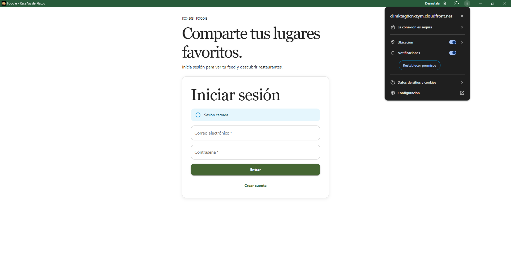
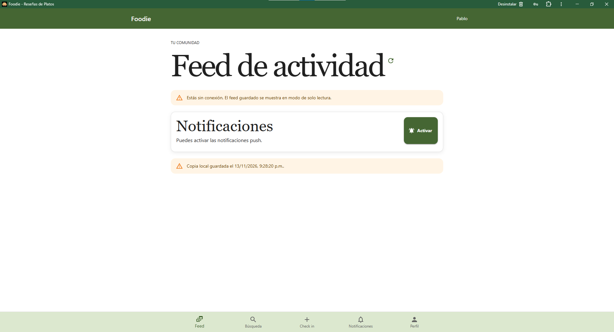
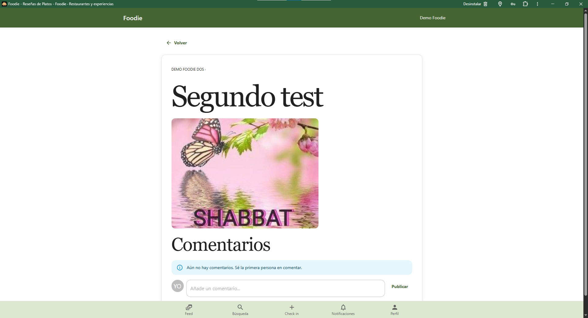

# Informe de Entrega 4 — Foodie

## Aplicación e integrantes

- **Aplicación:** Foodie — Reseñas de Platos.
- **Integrantes:** Francisco Correa y Pablo Krumenaker.
- **Rama de entrega:** `entrega-4`.
- **Región AWS:** South America (São Paulo), `sa-east-1`.
- **Plataforma de la PWA:** Android (heredada de la verificación de Entrega 3).

## Despliegues y prototipo

- **Despliegue serverless para evaluar:** [https://d1mktag8cnxzym.cloudfront.net](https://d1mktag8cnxzym.cloudfront.net)
- **Despliegue monolítico conservado:** [https://grupo19.4203.iccuandes.org](https://grupo19.4203.iccuandes.org)
- **Prototipo de Figma de Entrega 1:** [Proyecto Apps Móviles](https://www.figma.com/design/QQkmMdfx5sqrGXNd0zAhW9/Proyecto-Apps-Moviles?node-id=14-666&t=s7DZ69UvWdV4uxBu-1)

## Cuentas de demostración

El despliegue serverless prepara datos docentes propios; no importa las cuentas ni los registros del despliegue monolítico. Las dos cuentas permiten recorrer contenido y relaciones sociales. La contraseña de demostración no es una credencial personal.

| Correo | Handle | Contraseña | Uso |
| --- | --- | --- | --- |
| `demo@example.com` | `@demo` | `demo-password` | Cuenta de demostración principal, con publicaciones, seguimientos y contenido público y privado. |
| `demo2@example.com` | `@demo2` | `demo-password` | Segunda cuenta para recorrer el feed y verificar interacciones y notificaciones dirigidas. |

## Arquitectura y recorrido de una solicitud

La aplicación mantiene el frontend React y el contrato funcional de la entrega anterior. El cambio principal es el backend y la persistencia: el build estático se guarda en un bucket privado de Amazon S3 y CloudFront lo publica por HTTPS. CloudFront sirve las rutas del frontend y envía `/api/*` a API Gateway. API Gateway dirige cada solicitud a la función Lambda responsable. Las funciones HTTP usan FastAPI adaptado a Lambda con Mangum.

| Componente AWS | Responsabilidad |
| --- | --- |
| Amazon CloudFront | Origen HTTPS de la aplicación; entrega el frontend y enruta `/api/*`. |
| Amazon S3 (frontend) | Almacena el build estático sin acceso público directo; CloudFront accede mediante OAC. |
| API Gateway | Enruta los endpoints al servicio Lambda correspondiente. |
| Lambda de cuentas | Registro, inicio/cierre de sesión y operaciones de suscripciones Push. |
| Lambda de dominio | Restaurantes, actividad, reseñas, evaluaciones, seguimientos, comentarios y feed. |
| Lambda de fotografías | Operaciones de imágenes y acceso autorizado al contenido almacenado en S3. |
| Lambda emisora de notificaciones | Recibe invocaciones internas, consulta suscripciones y envía mensajes Web Push. No tiene endpoint público. |
| Aurora DSQL | Persistencia relacional de cuentas y datos de la aplicación, incluidas las suscripciones. |
| Amazon S3 (fotografías) | Almacena los archivos de imágenes; su lectura respeta las reglas de visibilidad del backend. |
| Amazon CloudWatch | Registros para diagnosticar ejecución y errores de las funciones. |

Las sesiones se comparten entre las funciones HTTP mediante la configuración y persistencia común del backend. La cookie conserva los atributos `HttpOnly` y `Secure`; cada endpoint protegido autoriza en el backend. Las funciones no dependen de memoria local entre invocaciones.

### Extensiones propias migradas

Se añadieron a `serverless/backend` la tabla `push_subscriptions`, sus operaciones de almacenamiento, los endpoints de alta/baja y consulta de clave VAPID, el evento de notificación y la Lambda emisora. Las dependencias del emisor se empaquetan por separado, junto con las de cada función, mediante los manifiestos de paquetes. La publicación realizada confirmó que se preparan los paquetes Linux compatibles.

El despliegue incorpora la tabla e índice de suscripciones al esquema DSQL. La suscripción se registra asociada al usuario autenticado; al cerrar sesión el cliente solicita la baja de esa instalación. El endpoint expirado o inválido puede limpiarse al fallar el envío.

### Recorrido de una notificación

1. La operación de dominio guarda una actividad.
2. La resolución de destinatarios provista por el backend determina quién debe recibirla según seguimientos y visibilidad.
3. Si corresponde notificar, la Lambda de dominio invoca directamente a la Lambda emisora con el tipo e identificador de actividad y la lista de destinatarios resuelta.
4. El emisor consulta `push_subscriptions` para esos usuarios, envía Web Push a cada suscripción y trata los errores individualmente.
5. El service worker recibe el evento. Al hacer clic, `notificationclick` envía un `postMessage` a la aplicación para navegar con React Router.

La resolución del backend excluye al autor, elimina destinatarios repetidos y no genera destinatarios para actividad privada. Una publicación es una entrada del feed y genera como máximo un aviso por instalación suscrita; reseñar una foto existente no crea por sí solo otro aviso. El envío no forma parte de la transacción de dominio: una falla de Push no debe borrar una actividad ya guardada. El éxito del handler representa que se procesaron los intentos, no confirma que el dispositivo mostró el aviso.

## Mapa de las diecisiete épicas

Las rutas siguientes son las pantallas de la aplicación; los datos se obtienen desde los endpoints `/api/v1/...` correspondientes. Se puede abrir cada flujo desde la navegación o sus enlaces relacionados.

| Épica | Funcionalidad | Ruta o entrada principal |
| --- | --- | --- |
| 1 | Registro e inicio de sesión | `/login`, `/register` |
| 2 | Perfil de usuario y actividad | `/profile/:handle` (perfil propio o ajeno) |
| 3 | Buscar o crear restaurante | `/explore` |
| 4 | Explorar restaurantes en mapa | `/explore` (acción/vista de mapa) |
| 5 | Buscar por estilo de comida y cercanía | `/explore` (búsqueda avanzada) |
| 6 | Ficha de restaurante | `/restaurants/:id` |
| 7 | Check-in | `/restaurants/:id/check-in` |
| 8 | Publicar foto de un plato | `/restaurants/:id/upload` |
| 9 | Publicar fotos de menú o instalaciones | `/restaurants/:id/upload` |
| 10 | Reseñar un plato | `/photos/:id/review` (publicación), `/reviews/:id` (detalle) |
| 11 | Evaluar un restaurante y asociar fotos | `/restaurants/:id/evaluate`, `/evaluations/:id` (detalle) |
| 12 | Buscar usuarios por handle | `/notifications` (búsqueda de personas) |
| 13 | Seguir o dejar de seguir usuarios | `/notifications` (resultados) y `/profile/:handle` |
| 14 | Seguir o dejar de seguir restaurantes | `/restaurants/:id` |
| 15 | Ver el feed | `/feed` |
| 16 | Ver visitas de personas conocidas | `/restaurants/:id` (pestaña Personas) |
| 17 | Comentar fotos y consultar conversaciones | `/photos/:id` (detalle de fotografía) |

Las acciones de navegación pueden llevar al usuario a la misma pantalla por más de una entrada (feed, perfil, ficha o notificación). El contrato funcional completo se mantiene en [`backend/docs/api.md`](../../backend/docs/api.md).

## Configuración y despliegue reproducible

El despliegue se administra con los scripts Python de `serverless/scripts` y CloudFormation. No se utiliza el workflow del despliegue monolítico. Se requiere Python 3.14 y Node.js 22.12 o superior con npm. En Windows, abrir PowerShell en `serverless` y ejecutar:

```powershell
py -3.14 -m venv .venv
.\.venv\Scripts\Activate.ps1
python -m pip install -r requirements.txt
Copy-Item config.example.json config.local.json
```

En `config.local.json`, conservar la configuración del ejemplo y establecer como mínimo:

| Campo | Valor o propósito |
| --- | --- |
| `deployment_name` | `foodie-grupo-19`. |
| `region` | `sa-east-1`. |
| `expected_account_id` | Cuenta AWS asignada al grupo; no es un secreto. |
| `profile` | `null` para que Boto3 use las credenciales locales configuradas. |
| `frontend_dir` / `frontend_build_dir` | `../frontend` / `dist`. |
| `package_manager` | `npm`. |
| `frontend_environment` | Variables públicas de build que realmente use el frontend, por ejemplo `VITE_GOOGLE_MAPS_API_KEY`; la clave debe restringirse por referente HTTP al origen publicado y a localhost para desarrollo. |
| `notifications_enabled` | `true` después de configurar el emisor. |
| `vapid_public_key` / `vapid_subject` | Clave pública VAPID y contacto del emisor. |

La clave privada VAPID se proporciona en el entorno local como `VAPID_PRIVATE_KEY` durante el despliegue/actualización; no se agrega al JSON ni al repositorio. AWS recibe las credenciales de despliegue desde el proveedor de credenciales de Boto3 (perfil local o variables AWS), no desde el código. La identidad de despliegue requiere permisos para CloudFormation, Lambda, API Gateway, S3, CloudFront, IAM y preparación de DSQL. No se deben versionar credenciales ni usar la cuenta root.

Comprobar identidad antes de crear recursos; desplegar una vez; usar `update` para siguientes versiones:

```powershell
python scripts/deploy.py check
python scripts/deploy.py deploy
python scripts/deploy.py status
python scripts/deploy.py update
```

El comando `deploy` crea los recursos, prepara esquema y datos docentes, publica frontend y funciones, y devuelve la dirección CloudFront. `status` consulta el estado. `update` publica cambios conservando la infraestructura. La operación de actualización no debe volver a inicializar fixtures sobre datos existentes. Para eliminar recursos cuando ya no sean necesarios, seguir el procedimiento de `serverless/README.md` y confirmar el nombre del stack antes de hacerlo: eliminar el despliegue borra recursos asociados y puede borrar datos.

Las variables de entorno que pueden intervenir son `AWS_PROFILE` (si se usa perfil nombrado), o `AWS_ACCESS_KEY_ID`, `AWS_SECRET_ACCESS_KEY` y `AWS_SESSION_TOKEN` para credenciales temporales; `VAPID_PRIVATE_KEY`; y variables `VITE_` incluidas en `frontend_environment` para compilar el cliente. Las variables `VITE_` quedan visibles en el bundle, por lo que solo deben contener datos públicos. La clave privada VAPID, secretos de autenticación y credenciales AWS son secretos y no deben enviarse al frontend.


## Resultados reportados y verificaciones pendientes

El despliegue serverless terminó en `CREATE_COMPLETE`, se verificaron **15 tablas y 30 índices**, las funciones y permisos se prepararon y se publicó la aplicación en la URL indicada arriba. También se pudo crear una cuenta y utilizar la aplicación normalmente, se corrigió la configuración del mapa y los registros Lambda revisados eran correctos. En la etapa anterior se recibió una notificación y la publicación correspondiente apareció en el feed. La versión serverless incluye el emisor y sus endpoints.


### Evidencias

Guardar capturas sin cookies, credenciales ni endpoints de suscripción dentro de `docs/entrega4/evidencias/` y enlazarlas aquí. La evidencia reunida incluye capturas de la PWA instalada, el feed sin conexión y la notificación recibida/seleccionada. Aún falta adjuntar evidencia del estado antes y después de una actualización conservando datos, fotos y suscripciones.


### PWA instalada desde el despliegue serverless  


### Feed consultado sin conexión en CloudFront


### Notificacion recibida




## Pruebas automatizadas

Ejecutar desde la raíz del repositorio, en PowerShell:

```powershell
Push-Location frontend
npm ci
npm test
npm run build
Pop-Location
# Pruebas backend con PostgreSQL aislado
docker compose --profile test up --build --abort-on-container-exit --exit-code-from backend-tests backend-tests
docker compose --profile test down --remove-orphans

# Empaquetado de funciones Lambda (desde serverless, con el entorno virtual activo)
Push-Location serverless
python scripts/package.py
Pop-Location
```

Para el backend, desde la raíz del repositorio ejecutar la suite aislada en Docker. El comando de empaquetado se ejecuta desde `serverless` con el entorno virtual activado.

| Área | Resultado |
| --- | --- |
| Frontend (`npm test`, `npm run build`) | Pendiente de ejecutar en el commit final. |
| Backend (suite Docker) | Pendiente de ejecutar y registrar. |
| Empaquetado de las cuatro Lambdas (`python scripts/package.py`) | El grupo reportó que el empaquetado de notificaciones funciona; adjuntar comando/salida del paquete final. |

## Problemas conocidos y restricciones

- La clave de Google Maps requiere autorización del referente HTTP correspondiente al dominio CloudFront y a los orígenes locales; una clave sin esos referentes causa `RefererNotAllowedMapError`.
- La instalación, ejecución offline y Web Push dependen del soporte del navegador y de permisos explícitos del usuario. La prueba debe realizarse con HTTPS en CloudFront; `localhost` sirve para desarrollo, pero no representa completamente la instalación publicada.
- El despacho Web Push es best effort: un éxito de invocación confirma que se intentó procesar cada suscripción, no la entrega al dispositivo. El envío es posterior a guardar la actividad y no existe atomicidad entre DSQL y el proveedor Push.
- Los servicios de AWS pueden generar cargos mientras los recursos sigan creados. `status` no elimina infraestructura; usar el procedimiento de eliminación solo para recursos que ya no deban permanecer disponibles.
- La PWA serverless tiene origen, datos y suscripciones independientes del despliegue monolítico. No se migraron datos ni instalaciones de navegador desde la versión anterior.
- El modelo exacto de teléfono, versión del sistema operativo, navegador y resultados integrales de privacidad/offline/actualización deben registrarse tras la verificación final de la versión serverless.

## Uso de inteligencia artificial generativa

Se utilizó ChatGPT/Codex como asistente de programación para revisar el alcance, analizar y modificar código.

